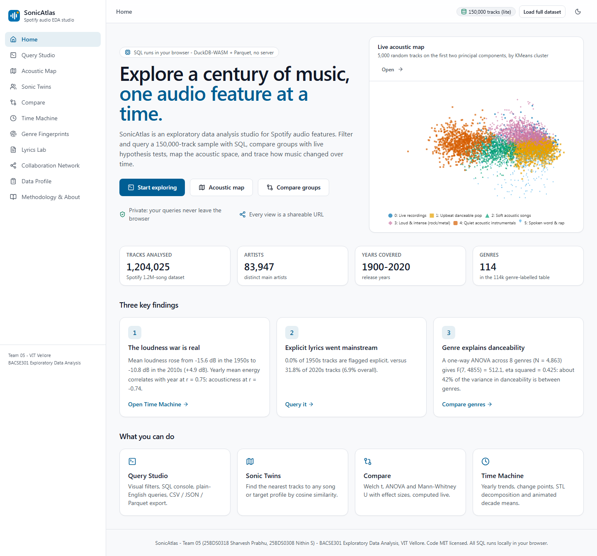
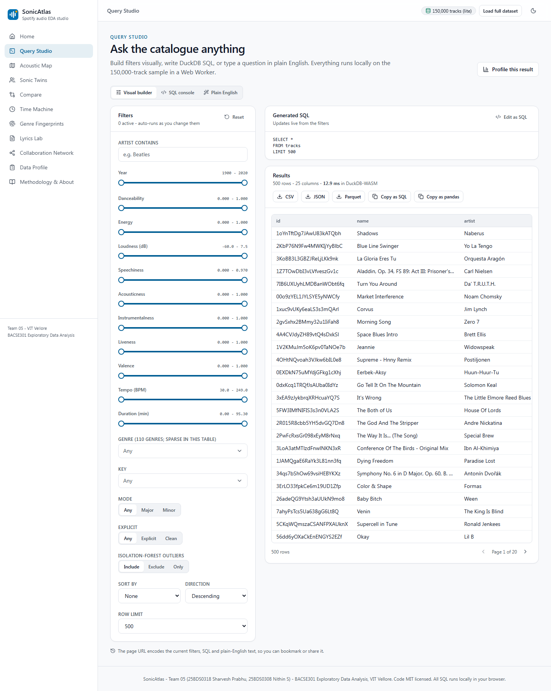
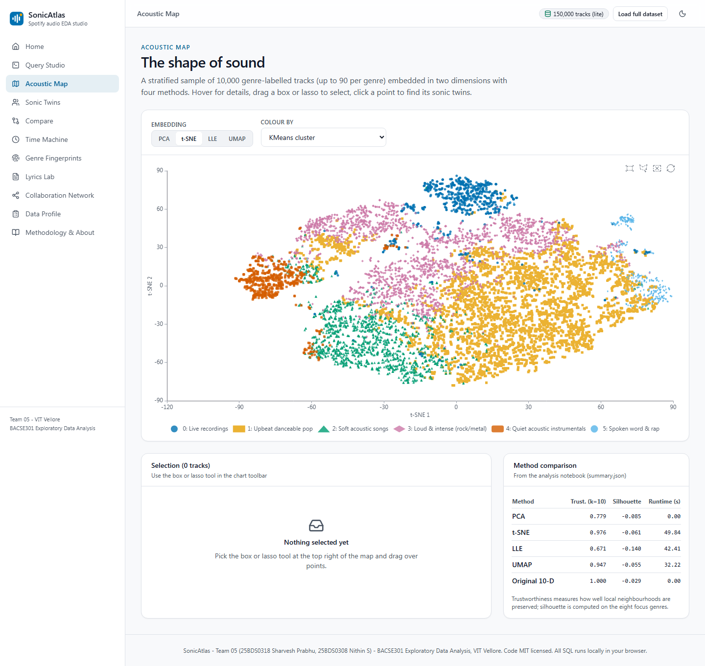
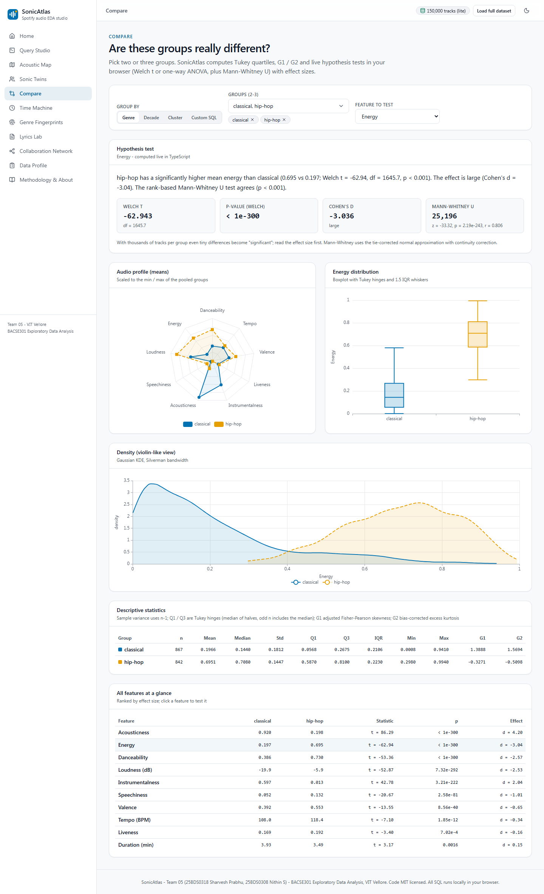
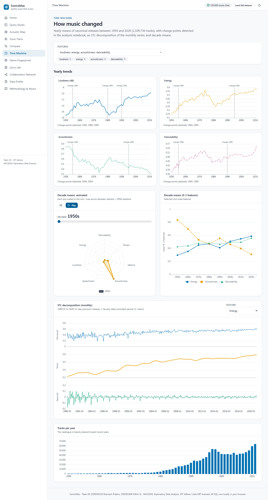
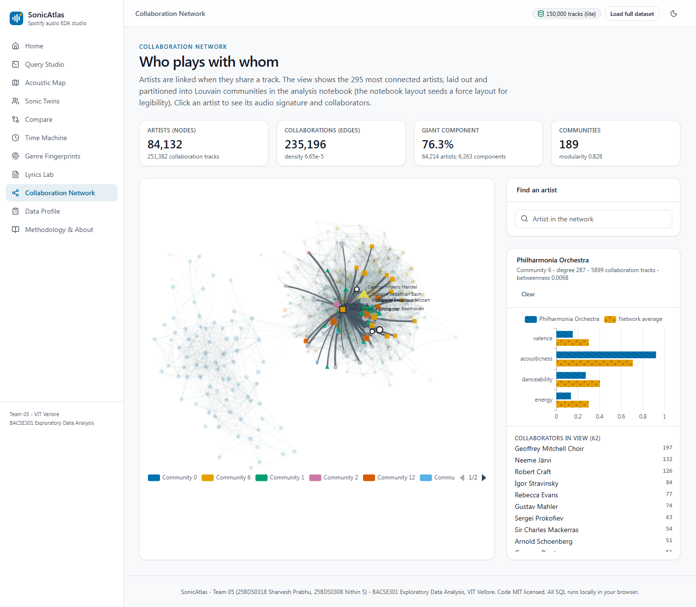

<div align="center">

# SonicAtlas

**SonicAtlas: An Interactive In-Browser Exploratory Data Analysis Platform for Multi-Dimensional Audio Features and Lyrics of Spotify Tracks Across Genres and Eras**

Team 05 - BACSE301 Exploratory Data Analysis - Vellore Institute of Technology, Vellore - Fall 2026

[Live website](https://nithin-ask.github.io/Team_05_25BDS0318_25BDS0308_SonicAtlas/) | [Demo video](https://github.com/Nithin-ASK/Team_05_25BDS0318_25BDS0308_SonicAtlas/releases/download/v1.0.0/Team_05_25BDS0318_25BDS0308_Demo_Video.mp4) | [Project report](deliverables/) | [IEEE paper](deliverables/)

</div>

     

## What and why
Spotify's archived audio descriptors (danceability, energy, valence, acousticness, ...) are one of the few open windows onto
the sound of recorded music, but most analyses of them are static charts. SonicAtlas is (1) a reproducible EDA pipeline over
**1,204,025 tracks** (1900-2020), **89,740 genre-labelled tracks in
114 genres** and **161,401 English lyrics**, and (2) a static website where anyone can filter,
query (SQL in the browser via DuckDB-WASM), map and compare the data - no server, no sign-up, data never leaves the browser.

## Key findings
- Music got **7.8 dB louder** between 1959 and 2020, with loudness change points in 1989, 1999 ("loudness war"); acousticness fell from 0.86 to 0.31.
- Energy is almost a restatement of loudness (Pearson r = 0.82) and the opposite of acousticness (r = -0.80).
- Genre explains **42.5%** of the variance in danceability (ANOVA F = 512.1, p < 0.001), yet genres overlap in every 2-D embedding (negative genre silhouettes).
- t-SNE preserves local structure best (trustworthiness 0.976), then UMAP (0.947), PCA (0.779) and LLE (0.671).
- Lyric sentiment is nearly unrelated to musical valence (r = 0.06, n = 1,202 matched songs).

## Quick start
```bash
# Python analysis (Python 3.13)
python -m venv .venv && .venv/Scripts/activate        # Windows; use bin/activate on Linux/macOS
pip install -r requirements.txt && pip install -e .
python docs_build/download_data.py                   # public Kaggle endpoint, no token needed
python docs_build/build_notebooks.py                 # runs notebooks 01-10 (09 needs requirements-profiling.txt in .venv-profiling)
python -m sonicatlas.web_export                      # writes web/public/data
pytest -q

# Website
cd web && npm ci && npm run dev                      # http://localhost:5173
npm test && npx playwright test                      # unit + end-to-end tests
npm run build                                        # static site in web/dist
```
Documents (report, decks, paper, proof, self-check) are generated from `reports/results.json` by the scripts in `docs_build/`
(see the `Makefile`: `make report ppt paper proof plagcheck`).

## Publish on GitHub Pages
1. Create an empty GitHub repository and push this folder (`git remote add origin <url> && git push -u origin main`).
2. In the repository settings, set **Pages -> Source = GitHub Actions**. The workflow `.github/workflows/deploy-pages.yml` builds `web/` and deploys `web/dist`.
3. Upload `data/processed/tracks_full_web.parquet` as a Release asset and set its URL in `web/src/config.ts` (`FULL_DATA_URL`) for the optional full-data tier.

## Tech stack
Python (pandas, scikit-learn, statsmodels, ruptures, umap-learn, networkx, VADER, TextBlob), Jupyter, YData-Profiling,
Sweetviz, D-Tale; Vite + React + TypeScript, Tailwind CSS, DuckDB-WASM, Apache ECharts; Playwright, Vitest, Lighthouse;
python-docx, pptxgenjs, LaTeX (IEEEtran) for documents.

## Repository layout
`data/` (raw data not committed; see data/README.md) - `notebooks/` (01-10, with outputs; sources in notebooks/src) -
`src/sonicatlas/` (package: stats, theme, results, web export) - `tests/` - `web/` (website) - `reports/` (figures, tables,
profiling, results.json) - `docs_build/` (document generators) - `deliverables/` (final files).

## Honest limitations
Spotify descriptors are outputs of proprietary models; the catalogue over-represents recent years; only
10.7% of genre-labelled tracks could be joined to the audio table; lyrics are English-only; the 2020s
contain one year. See DECISIONS.md for every judgement call.

## Team
- Sharvesh Prabhu (25BDS0318)
- Nithin S (25BDS0308) - nithin.s2025a@vitstudent.ac.in

Course: BACSE301 Exploratory Data Analysis, VIT Vellore. Faculty: ____________.

## Licence
Code: MIT (see LICENSE). Data: see the licence of each Kaggle dataset in data/README.md; raw data and lyric text are not
redistributed.
